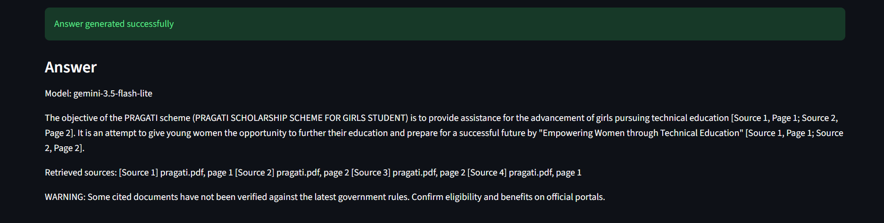
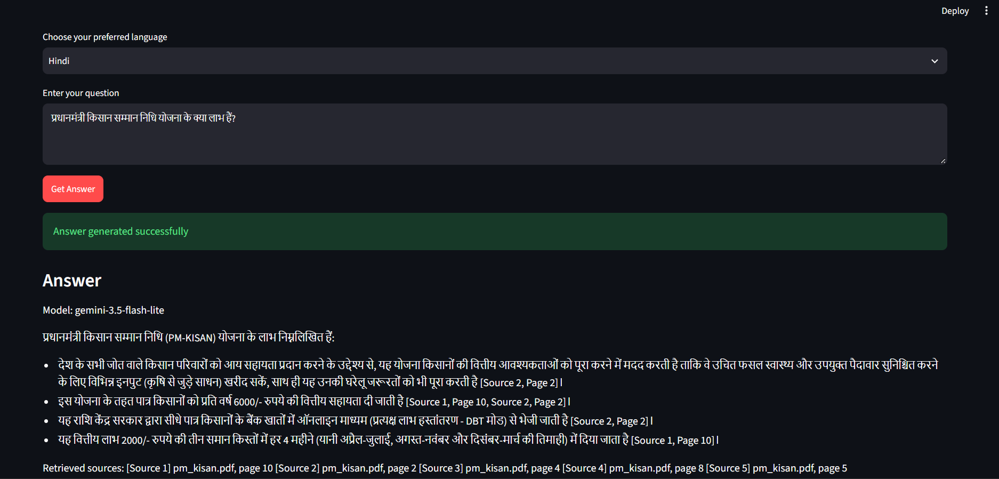
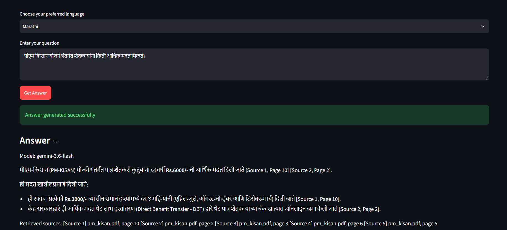
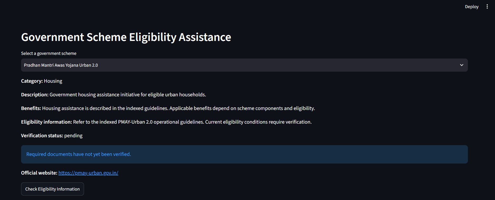

# YojanaRAG

### Explainable Multilingual Government Scheme Question Answering and Eligibility Assistance Using RAG

**An AI-powered multilingual assistant for exploring Indian government schemes through document-grounded question answering and rule-based eligibility assistance.**


## Overview

YojanaRAG is an AI & Data Science mini-project designed to make government scheme information easier to explore.

Users can ask questions in English, Hindi, or Marathi. The application retrieves relevant information from indexed government scheme PDFs and uses Google Gemini to generate evidence-grounded answers with source references.

The project also includes structured, rule-based eligibility assistance. These results are advisory and do not represent official eligibility decisions.

## Key Features

- Multilingual questions in English, Hindi and Marathi
- Government scheme PDF processing and indexing
- Multilingual sentence embeddings
- FAISS semantic similarity search
- BM25 keyword-based retrieval
- Reciprocal Rank Fusion (RRF)
- Cross-encoder reranking
- Gemini-powered grounded answer generation
- Document and page-level source references
- Offline evidence fallback when generation is unavailable
- Structured rule-based eligibility assistance
- Historical-source warnings and eligibility safeguards
- Interactive Streamlit interface

## System Architecture

The project follows a hybrid retrieval-augmented generation architecture.

1. Extract and chunk government scheme PDF content.
2. Create multilingual embeddings and a FAISS index.
3. Build a BM25 keyword index.
4. Process multilingual user queries.
5. Retrieve relevant evidence using semantic and keyword search.
6. Combine results using Reciprocal Rank Fusion.
7. Rerank evidence with a cross-encoder.
8. Generate grounded answers with Gemini.
9. Present responses with source references through Streamlit.

Eligibility assistance uses a separate structured rule-evaluation workflow.

**[View Detailed System Architecture](docs/architecture/ARCHITECTURE.md)**

## Application Screenshots

The following screenshots were captured during local application testing.

### English Question Answering



### Hindi Question Answering



### Marathi Question Answering



### Government Scheme Eligibility Assistance



## Technology Stack

| Component | Technology |
|---|---|
| Programming Language | Python |
| User Interface | Streamlit |
| Semantic Retrieval | FAISS |
| Keyword Retrieval | BM25 |
| Hybrid Ranking | Reciprocal Rank Fusion |
| Reranking | Cross-Encoder |
| Embeddings | Sentence Transformers |
| Answer Generation | Google Gemini API |
| Data Validation | Pydantic |
| Testing | Pytest |
| Source Documents | Government Scheme PDFs |

## Government Schemes

The local knowledge base includes documents associated with:

- PM-KISAN
- PMAY Urban 2.0
- PMKVY 4.0
- PMMVY
- PRAGATI

Source documents may represent historical guidelines rather than current official requirements.

## Installation

### 1. Clone the Repository

```powershell
git clone https://github.com/AyushShirke9794/yojnarag.git
cd yojnarag
```

### 2. Create a Virtual Environment

```powershell
python -m venv .venv
.\.venv\Scripts\Activate.ps1
```

### 3. Install Dependencies

```powershell
python -m pip install -r requirements.txt
```

### 4. Configure Gemini API

Create a `.env` file in the project root:

```text
GEMINI_API_KEY=your_api_key_here
```

Never commit actual API keys.

### 5. Run the Application

```powershell
python -m streamlit run app.py
```

Open http://localhost:8501 in your browser.

## Testing

Run automated tests:

```powershell
python -m pytest tests -v
```

**Last recorded local result: 8 tests passed.**

The tests cover foundational project behavior, including database loading, historical-source safeguards, basic rule evaluation and required artifacts.

They do not constitute a complete evaluation of multilingual answer accuracy or retrieval performance.

## Important Limitations

- Government scheme rules may change over time.
- Some indexed documents are historical, including PM-KISAN operational guidelines dated 29 March 2020.
- Current eligibility requirements have not been independently verified.
- Gemini API access depends on the configured account and quota.
- Eligibility assistance is informational, not an official government determination.
- The application is currently a local prototype and is not publicly deployed.

## Future Improvements

- Expand the scheme knowledge base
- Refresh and verify official source documents
- Add comprehensive multilingual retrieval and generation benchmarks
- Improve eligibility rule coverage
- Deploy the application online

## Developer

**Ayush Shirke**

B.E. Artificial Intelligence & Data Science

A. C. Patil College of Engineering, Kharghar, Navi Mumbai

[GitHub Profile](https://github.com/AyushShirke9794)

## Disclaimer

YojanaRAG is an educational AI project. For current scheme benefits, required documents, application procedures and eligibility decisions, always consult the relevant official government portal.
